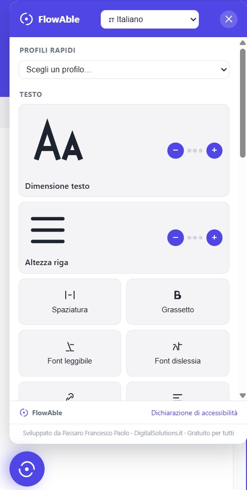

# FlowAble

FlowAble is a standalone, zero-dependency accessibility toolbar for websites. Drop in one script and one stylesheet — no jQuery, no build step, no external services — and your site gets a floating accessibility panel with 25+ tools: text and reading adjustments, color/contrast modes, a screen-reader-style hover reader, a full text-to-speech reader, an on-screen virtual keyboard, and more.

Everything runs client-side. FlowAble never sends browsing data anywhere; all preferences are stored in the visitor's own `localStorage`.

Developed by **Passaro Francesco Paolo** — [DigitalSolutions.it](https://www.digitalsolutions.it).

---

## Demo

Open [`demo/index.html`](demo/index.html) in a browser (or via GitHub Pages, if enabled for this repo) to try FlowAble on a sample page.



---

## Installation

Copy `src/flowable.js` and `src/flowable.css` into your project and reference them from your page (path shown relative to your own `src`/`css` folders — adjust as needed):

```html
<link rel="stylesheet" href="/path/to/flowable.css">
...
<script src="/path/to/flowable.js"></script>
```

That's it. On load, FlowAble injects its own floating button (bottom-left of the viewport) and builds its panel on demand — there is no HTML markup to add and no server-side integration required.

### Optional configuration

Set `window.FlowAbleConfig` **before** the `<script>` tag loads if you want to force an initial UI language instead of letting FlowAble auto-detect it from the browser's own locale:

```html
<script>
  window.FlowAbleConfig = { lang: 'fr' }; // any of the 35 supported codes, see below
</script>
<script src="/path/to/flowable.js"></script>
```

FlowAble's own UI language is completely independent from your site's language/culture — it is never read from `<html lang>` or any server-rendered value, so the same two files behave identically on any website.

---

## Keyboard shortcut

`Alt + .` (Windows/Linux) or `⌘ + .` (Mac) toggles the panel open/closed from anywhere on the page.

---

## Features

### Quick profiles

One-click bundles of settings for common needs, available from a dropdown at the top of the panel:

| Profile | What it sets |
|---|---|
| Vision impaired | Larger text (step 2), high contrast, readable font |
| Seizure safe | Stops animations, desaturates colors |
| ADHD friendly | Reading mask, stops animations, hides images |
| Blindness | Largest text (step 3), big cursor, keyboard navigation |
| Epilepsy safe | Stops animations, monochrome |

### Text

| Feature | Description |
|---|---|
| **Font size** | 3-step increase, applied via a root-level class plus targeted rules on common text tags (paragraphs, links, headings, list items, table cells, labels, blockquotes) — deliberately avoids touching layout containers (`div`, `button`) so it can't distort the page grid. |
| **Line height** | 3-step increase on paragraphs and list items. |
| **Letter spacing** | Adds letter-spacing across text elements. |
| **Bold** | Forces bold weight on body text. |
| **Readable font** | Switches text to a high-legibility system font stack (Verdana/Tahoma/Segoe UI/Arial). |
| **Dyslexia font** | Wider letter/word spacing and increased line height with the same high-legibility stack — deliberately uses only fonts already present on end-user devices rather than a downloaded webfont, so the module stays dependency-free. |
| **Highlight links** | Yellow background + underline on every link. |
| **Highlight titles** | Yellow background on every heading (`h1`–`h6`). |
| **Highlight everything** | Yellow background on paragraphs, list items, and spans. |
| **Align text** | Cycles page text alignment: left → center → right → off. |
| **Big cursor** | Replaces the mouse cursor with a large high-contrast arrow. |
| **Text magnifier** | Enlarges (and highlights) whichever text element — link, heading, paragraph, list item, table cell, blockquote, label — is currently under the pointer. |
| **Magnifier + word reading** | Same hover-magnify behavior, plus reads the **full text of the hovered element** aloud (e.g. hovering a link reads the whole link text, not a single word) via the Web Speech API. |

### Color

| Feature | Description |
|---|---|
| **Dark contrast** | Dark background, light text. |
| **Light contrast** | Forces a light background with a slight contrast boost. |
| **High contrast** | Black background, white text, yellow links. |
| **Monochrome** | Grayscale filter over the page. |
| **Desaturate** | Reduces color saturation without full grayscale. |

### Orientation & reading

| Feature | Description |
|---|---|
| **Reading line** | A highlighted horizontal band that follows the mouse vertically, to help track a line of text. |
| **Reading mask** | Dims everything above and below a band around the cursor. |
| **Read page** | Full text-to-speech reading of the page's main content (`main`, `article`, `.content`, or similar), split into sentence-sized chunks and read sequentially, with play/pause/stop. |
| **Keyboard navigation** | Strong, visible focus outlines on every focusable element, for users tabbing through the page with a physical keyboard. |
| **Hide images** | Hides images, pictures, and videos. |
| **Mute sounds** | Mutes all `<audio>`/`<video>` elements on the page, including ones added dynamically afterward. |
| **Stop animations** | Disables CSS animations/transitions and smooth scrolling site-wide. |

### Virtual keyboard

A separate on-screen keyboard for users who can only operate a mouse/touchscreen (no physical keyboard):

- Appears automatically, positioned right below (or above, if there's no room) whichever text input, textarea, contenteditable field, or `<select>` the user focuses.
- Works on `<select>` elements as a letter-based typeahead — clicking a letter jumps to (and cycles through) matching options, the same way typing a letter on a physical keyboard does on a focused native select.
- Includes Shift, Space, Backspace, and Enter keys.
- **Larger keys** toggle (an "A+" button on the keyboard itself) increases key size and font size for users with motor or vision difficulties — saved as its own preference.
- If turned on while no field is focused yet, it shows in a default on-screen position for immediate visible confirmation, then repositions itself the moment a real field is focused.

### Go to

A quick-jump dropdown to skip directly to the page's main content, navigation/menu, or footer — useful for keyboard and screen-reader users who want to bypass repeated boilerplate.

### Other

| Feature | Description |
|---|---|
| **Virtual keyboard** | See above. |
| **Hide toolbar** | Hides FlowAble's own floating button for the current session, 24 hours, or a week (stored in `localStorage`/`sessionStorage`; the toolbar reappears automatically once the period expires). |
| **Reset settings** | Restores every setting to its default in one click (keeps the chosen UI language). |
| **Accessibility statement** | A short built-in statement (translated in every supported language) explaining that FlowAble runs entirely client-side, plus an "About FlowAble" note crediting the author and license. |

---

## Supported languages

FlowAble's panel — labels, buttons, and the accessibility statement — is available in 35 languages, each with its own flag in the language selector at the top of the panel. The UI language is fully independent of the host page: it defaults to the browser's own locale (`navigator.language`) and can be changed from the panel itself (or forced via `window.FlowAbleConfig.lang`, see [Installation](#optional-configuration)) without ever touching the host site's own language/culture.

| Code | Language | Flag |
|---|---|---|
| `it` | Italiano | 🇮🇹 |
| `en` | English | 🇬🇧 |
| `fr` | Français | 🇫🇷 |
| `de` | Deutsch | 🇩🇪 |
| `es` | Español | 🇪🇸 |
| `pt` | Português | 🇵🇹 |
| `ru` | Русский | 🇷🇺 |
| `zh` | 中文 | 🇨🇳 |
| `ar` | العربية | 🇸🇦 |
| `ja` | 日本語 | 🇯🇵 |
| `ko` | 한국어 | 🇰🇷 |
| `nl` | Nederlands | 🇳🇱 |
| `pl` | Polski | 🇵🇱 |
| `tr` | Türkçe | 🇹🇷 |
| `sv` | Svenska | 🇸🇪 |
| `da` | Dansk | 🇩🇰 |
| `fi` | Suomi | 🇫🇮 |
| `no` | Norsk | 🇳🇴 |
| `el` | Ελληνικά | 🇬🇷 |
| `cs` | Čeština | 🇨🇿 |
| `hu` | Magyar | 🇭🇺 |
| `ro` | Română | 🇷🇴 |
| `uk` | Українська | 🇺🇦 |
| `he` | עברית | 🇮🇱 |
| `hi` | हिन्दी | 🇮🇳 |
| `th` | ไทย | 🇹🇭 |
| `vi` | Tiếng Việt | 🇻🇳 |
| `id` | Bahasa Indonesia | 🇮🇩 |
| `ms` | Bahasa Melayu | 🇲🇾 |
| `bg` | Български | 🇧🇬 |
| `sk` | Slovenčina | 🇸🇰 |
| `hr` | Hrvatski | 🇭🇷 |
| `sr` | Српски | 🇷🇸 |
| `lt` | Lietuvių | 🇱🇹 |
| `lv` | Latviešu | 🇱🇻 |
| `et` | Eesti | 🇪🇪 |

Full panel translations (every label, button, and the accessibility statement) are provided for: Italian, English, French, German, Spanish, Portuguese, Russian, Chinese, Arabic, Japanese, Korean, Dutch, Polish, Turkish, and Greek. The remaining languages in the selector are available for the text-to-speech voice/locale and are shown in the flag list; their panel UI currently falls back to English text until translated. Contributions of additional full translations are welcome (see [Contributing](#contributing)).

---

## Speech synthesis notes

Both "Read page" and "Magnifier + word reading" use the browser's built-in [Web Speech API](https://developer.mozilla.org/en-US/docs/Web/API/Web_Speech_API) (`speechSynthesis`) — no cloud service, no API key, no network call. Available voices and language quality depend entirely on the visitor's own browser/OS.

"Read page" splits the page's readable text into sentence-sized chunks and speaks them sequentially (rather than as one giant utterance) to avoid two well-known browser engine quirks: very long utterances can silently stop partway through, and an utterance object with no surviving JavaScript reference can be garbage-collected mid-speech, cutting playback off after only the first word or two. FlowAble keeps a live reference to the utterance currently playing to prevent that.

---

## Design decisions worth knowing

- **No custom webfont for dyslexia support.** Rather than downloading a font like OpenDyslexic (which would mean an external dependency or a bundled binary asset), FlowAble's dyslexia mode uses wider letter/word spacing plus a high-legibility system font already installed on virtually every device.
- **Font-size scaling is deliberately conservative.** It targets text-level tags only (paragraphs, spans, links, headings, list items, table cells, labels, blockquotes) and never touches `div`/`button`/layout containers, because many sites use em-relative spacing on those and a broader approach can visibly distort the page grid.
- **The "magnifier + word reading" feature reads whole elements, not the word under the cursor.** Early versions read literally the word closest to the pointer; this was changed so that hovering, say, a link reads the entire link text — closer to how a real screen reader announces an element.
- **No dependency on the host page's language.** FlowAble's own UI language is never derived from `<html lang>` or any other host-page/server value — it is entirely self-contained so the same two files work identically dropped into any site.

---

## Browser support

Works in any modern evergreen browser (Chrome, Edge, Firefox, Safari). Text-to-speech features degrade gracefully (buttons simply have no effect) if `window.speechSynthesis` isn't available; the virtual keyboard's typeahead-on-select and cursor-position helpers use standard DOM APIs supported everywhere FlowAble targets.

---

## Contributing

Issues and pull requests are welcome — in particular, additional full-language translations of the panel (see [Supported languages](#supported-languages)) and accessibility bug reports.

---

## License

Free to use for any business or personal purpose. You may not modify the source code or copy/redistribute it separately from this project. All rights reserved by the author. See [`LICENSE`](LICENSE) for the full text.

---

**Author:** Passaro Francesco Paolo — [DigitalSolutions.it](https://www.digitalsolutions.it)
